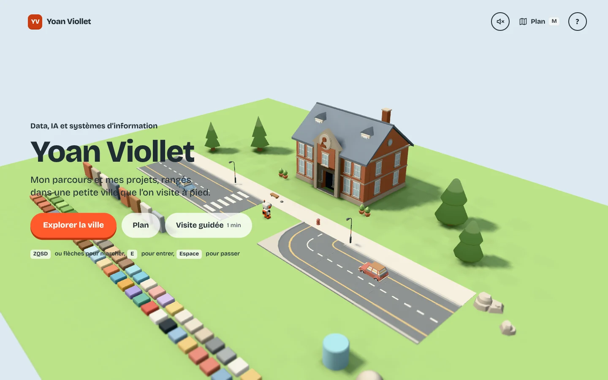
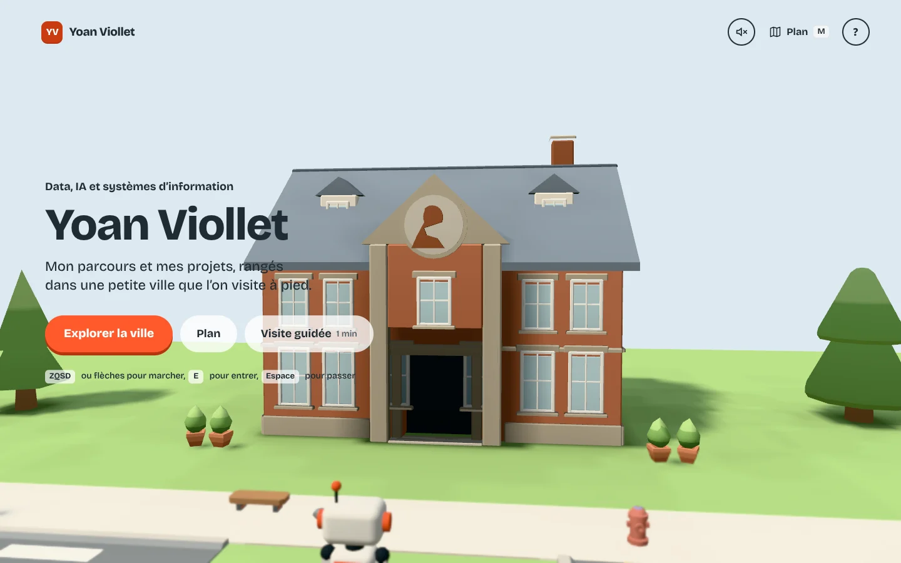
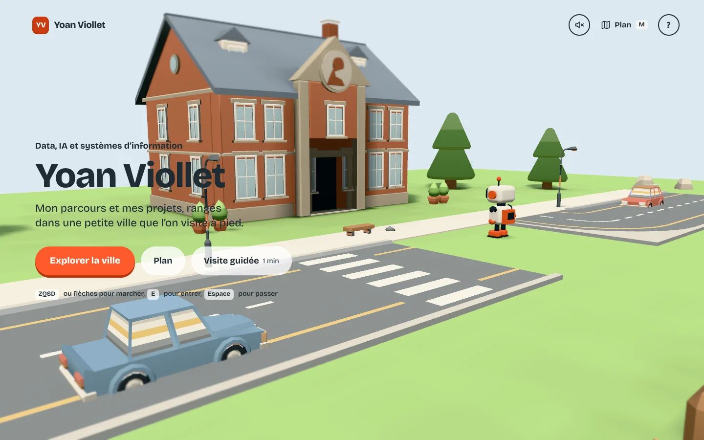
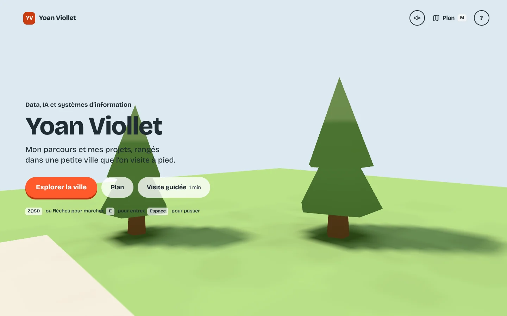
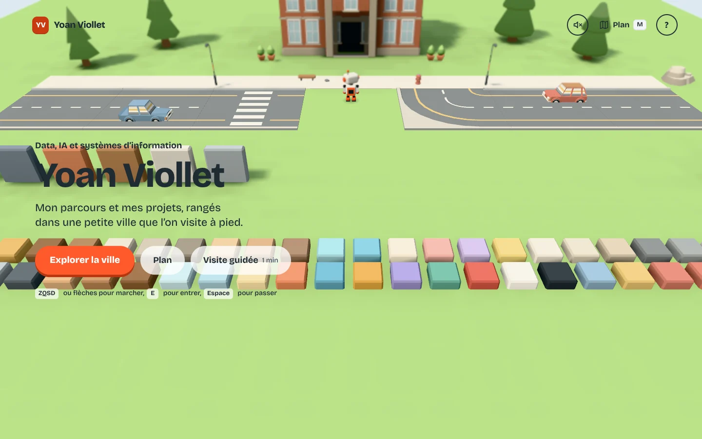
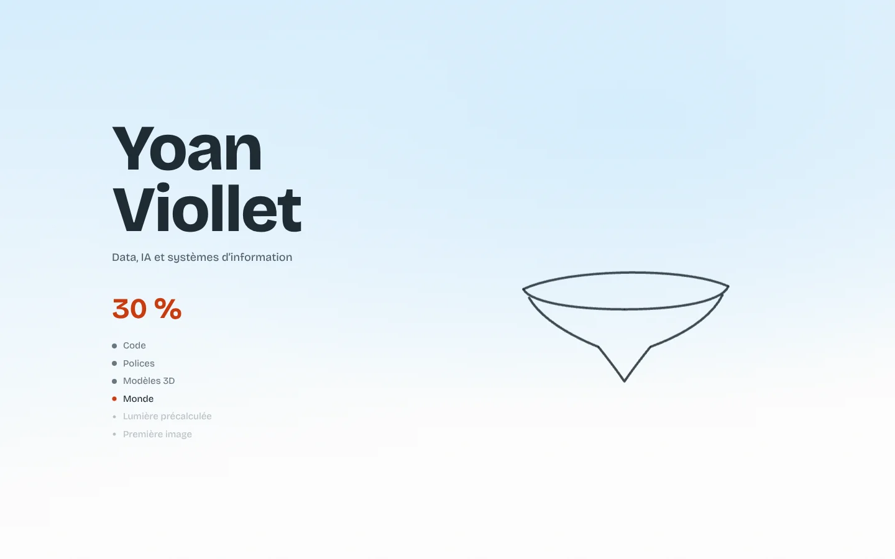
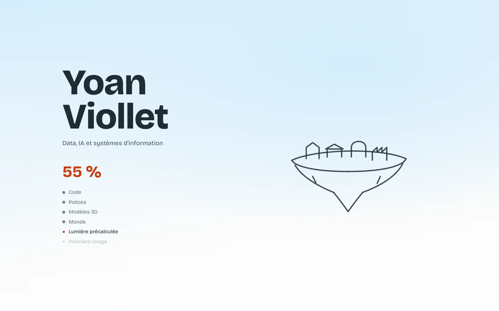
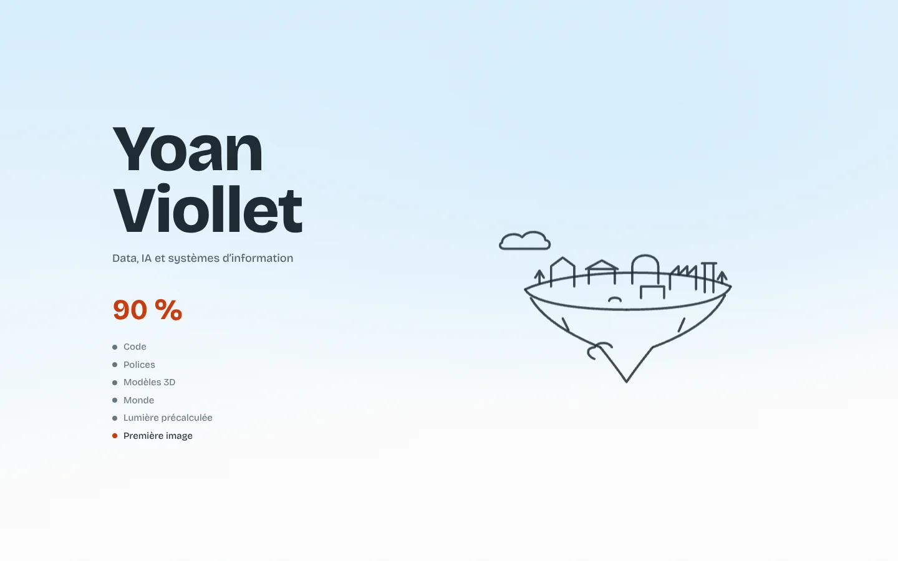

# CareerVerse V8 — suivi et vérifications

Date : 15 novembre 2026. Base : `main` au commit `a545e6b` (V7 en ligne). Travail sur la branche imposée par l'environnement, `claude/careerverse-v4-refactor-7f688a`, repartie de `main` ; une PR, rien n'est fusionné dans `main`. Le contenu reste vide.

## Direction artistique (planche)

Planche `?debug=1&da` (`npm run capture:da`) : palette, matières, arbres, la maison du Profil et un bout de rue, éclairés comme le monde.

| Maison                                                    | Rue                                                    | Végétation                                                    | Palette                                                    |
| --------------------------------------------------------- | ------------------------------------------------------ | ------------------------------------------------------------- | ---------------------------------------------------------- |
|  |  |  |  |

- **Palette** (`src/world/palette.ts`) : 64 cases, verts tendres, pierre claire, terre cuite et ardoise ; six accents réservés aux enseignes et aux détails des lieux. L'atlas (8 × 8 cases en dégradé vertical doux, comme celui des kits) est généré au chargement : aucune image à télécharger.
- **Matière unique** (`src/scene/diorama/material.ts`) : un petit shader, quatre variantes (lumière par sommet, lumière du sol, lumière par exemplaire, objets mobiles). Pas d'ombre en temps réel, pas de contour.
- **Lumière précalculée une fois** (`src/geometry/bake.ts`, dans un worker) : champ de hauteurs à 0,5 m, ombre douce (5 rayons vers le soleil légèrement dispersés), occlusion ambiante par horizon dans 8 directions.
- **Ciel** en dégradé, léger brouillard, nuages arrondis (boules lisses, dessous bleuté) ; effet miniature (tilt-shift) très léger en qualité Soignée.

Rien dans la planche ne contredit le brief : la construction a continué sans attendre.

## Phase 1 — Pipeline des kits

- **Sources** : KayKit City Builder Bits 1.0, Medieval Hexagon Pack 1.0 (dossier nature) et Furniture Bits 1.0, de Kay Lousberg. Licence **CC0** vérifiée dans le `LICENSE.txt` de chaque dépôt, notée dans `public/LICENCES.md`.
- **City Builder Bits n'a aucun arbre** (seulement un buisson en pot), contrairement à ce que suggérait le brief : pins et sapins viennent du Medieval Hexagon Pack, même auteur, même licence, même principe d'atlas ; le feuillu est un modèle maison écrit avec les mêmes règles (facettes franches, même atlas). Une seule famille de végétation.
- **Pipeline** (`npm run kits`, `scripts/kits.mjs`) : seuls les modèles utilisés sont gardés (test `tests/kits.test.mjs`) ; chaque couleur d'origine est rangée dans une famille (gris, vert, bois, rouge…) et remplacée par une case de la palette selon sa luminance (rochers en pierre, métal sombre, carrosseries adoucies, tissus adoucis) ; primitives fusionnées en un maillage par modèle, soudure, quantification, compression meshopt. Les répétitions sont instanciées au rendu (un appel de dessin par modèle).
- **Poids** : `ville.glb` 70 Ko (18 modèles), `meubles.glb` 109 Ko (22 modèles, chargé à l'entrée du premier lieu). Total 179 Ko, budget 1,5 Mo.
- **Progression réelle** : octets reçus du GLB (étape « Modèles »).

## Phase 2 — Implantation sur grille

- **Plan** (`src/world/plan.ts`) : grille de 4 m ; boucle de rues en tuiles KayKit de 8 m (les voitures y circulent sans demi-tour) ; trottoirs de 3 m ; place centrale et fontaine ; six parcelles disjointes. Les bâtiments ont été déplacés : trois au nord face à la place (Profil, galerie, observatoire), l'atelier à l'ouest, Veolia à l'est (cour des cuves visible de l'accueil), le pavillon de verre au sud.
- **Placeur** (`src/world/placer.ts`) : chaque objet n'est accepté que dans les zones qui lui sont destinées ; distances minimales (rayons + 0,3 m) ; rien hors de l'île ni flottant ; aucun arbre contre une façade ni devant une porte ; lampadaires d'équerre à 0,7 m de la chaussée. Tests : `tests/v8.test.mjs` (et le test d'emprise relevé sur les maillages).
- **Relief** : sol plat partout où l'on construit et circule ; quelques buttes douces dans les pelouses éloignées.
- **Île** (`src/geometry/island.ts`) : sol en anneaux marbré, rebord d'herbe arrondi, falaise en strates douces, dessous bosselé jusqu'à la pointe, rochers arrondis, racines qui pendent.

## Phase 3 — Six bâtiments

Une fiche par bâtiment avant le code (`docs/batiments/<id>.md`), une écriture chacun, mêmes formes chanfreinées et même atlas que les kits (`src/geometry/shapes.ts`, `elements.ts`) :

| Lieu            | Écriture                | Points clés                                                                              |
| --------------- | ----------------------- | ---------------------------------------------------------------------------------------- |
| Profil          | brique, pierre, ardoise | avant-corps à fronton, médaillon-portrait en relief, lucarnes, jardin                    |
| Projet 1        | verre et acier          | deux niveaux de mur-rideau, dalles blanches débordantes, toit équipé                     |
| Projet 2        | brique et acier         | trois sheds du même système, quai fermé sous auvent, cour murée, cheminée                |
| Projet 3        | enduit, bandeau lavande | tambour à 12 pans (fenêtres plates sur faces plates), dôme à fente, terrasse et escalier |
| Autres missions | enduit et pierre        | portique de quatre colonnes, fronton, toit de zinc et verrière                           |
| Veolia          | béton, bandeau rouge    | cuves sur socle, passerelle, échelles, conduites raccordées, bassin                      |

Portes en embrasure de 1 m sur fond sombre (rien de l'intérieur n'est visible), seuils à moins de 0,3 m (le robot marche au sol). La porte de la galerie est au fond du portique : `door` dans `config.ts`, utilisé par la séquence d'entrée et les collisions (le portique est praticable, les colonnes bloquent).

## Phase 4 — Herbe et vie

- **Herbe** (`src/scene/Herbe.tsx`) : brins instanciés, vent et couchage autour du robot dans le shader, teintes variées, fleurs, cailloux ; éclairée par la lumière du sol (ombre des bâtiments et des arbres). 7 brins/m² en Soignée, 2,2 en Légère ; masquée au loin (accueil, vols), la texture du sol suffit.
- **Actions du robot** : s'asseoir sur un banc (E à moins de 2 m), se relever au premier mouvement, saluer (H), regarder autour de lui, pencher la tête, s'étirer quand il attend ; portes qui s'ouvrent à l'entrée (inchangé).
- **Vie** (`src/scene/Vie.tsx`) : jardinier (Profil), livreur et sa camionnette (Projet 1), chariot élévateur dans la cour (Projet 2), astronome au télescope sur la terrasse (Projet 3), agent autour du bassin (Veolia), visiteur sous le portique (galerie). Figurines sans visage ; ils s'arrêtent quand le robot approche et ne bloquent aucun passage. Oiseaux qui s'envolent à moins de 7 m ; deux voitures sur la boucle, arrêtées par le robot ; éclaboussures dans la fontaine.

## Phase 5 — Le robot, du départ à l'arrivée

- **Accueil** : le robot attend sur un îlot (pointe rocheuse, strates, herbe, balise lumineuse, buisson) à gauche de l'île, avec son ombre douce ; il regarde le curseur, balaie l'île du regard, salue au survol ou au focus d'« Explorer la ville ». Sur téléphone, l'îlot est au-dessus de la carte.
- **Timeline** (`src/world/flight.ts`, un seul fichier de réglages) : accroupi 0,4 s, saut et allumage 0,3 s, croisière 1,9 s (arc au-dessus des toits, penché, incliné dans les virages, traînée), redressement et freinage 0,45 s, atterrissage 0,3 s (écrasement, anneau de poussière, son). Total 3,35 s, passable par clic, toucher ou touche.
- **Caméra** : travelling de trois quarts (65° de l'arrière, jamais de dos), en plongée, à distance constante (le robot occupe environ 15 % de la hauteur d'écran) ; raccords sans saut d'échelle avec la vue d'accueil et la vue de ville.
- **Retour** : chemin inverse jusqu'à l'îlot ; le robot se retourne vers la ville avant de se poser. Réduire les animations : fondu simple, pas de vol.

## Phase 6 — Page de chargement

Nom en grand, île dessinée au trait (20 traits allumés au rythme du chargement), pourcentage en chiffres alignés, étapes réelles (code, polices, modèles 3D, monde, lumière précalculée, première image), fond en dégradé grainé. Animations en CSS seulement (transform, opacity) ; affichage minimal de 0,6 s ; dévoilement en fondu, puis retrait du DOM. Le monde (géométrie et lumière) se construit dans un worker ; les shaders sont compilés avec `compileAsync`.

Mesures (`npm run mesure:chargement`, Chromium sans écran, rendu logiciel SwiftShader, 1440 × 900, qualité Soignée, médiane de 3 ; V7 rebâtie depuis `a545e6b` et mesurée dans les mêmes conditions) :

| Version | Prête (première image) | Plus longue tâche pendant le chargement | Tâches > 200 ms pendant le chargement | Transféré |
| ------- | ---------------------: | --------------------------------------: | ------------------------------------: | --------: |
| V7      |                  8,4 s |                                2 707 ms |                                     1 |    450 Ko |
| V8      |              **2,2 s** |                              **125 ms** |                                 **0** |    560 Ko |

Relevés bruts : `docs/screenshots/v8/chargement/mesure-v7.json` et `mesure-v8.json`. Budget du premier affichage : 2,5 Mo, tenu (560 Ko, intérieurs exclus). La plus longue tâche _après_ le dévoilement (compilation de l'effet miniature, chargé après la première image) va de 0,2 à 1,1 s selon les essais : elle ne fige pas la page de chargement, mais peut faire sauter une image juste après le dévoilement (à vérifier sur un vrai GPU, où elle est bien plus courte).

Ce qui a fait la différence : un seul petit shader au lieu de dizaines de programmes, la géométrie et la lumière calculées dans un worker, l'herbe semée dans ce même worker (une première mesure, l'herbe semée sur le fil principal, donnait une tâche de 322 ms).

Captures à quatre étapes (`docs/screenshots/v8/chargement/`) : le chargement réel est trop rapide pour être saisi au vol (moins de 4 s même processeur ralenti) ; chaque étape est donc figée par `?debug=1&chargement=<étape>`, avec le même code d'affichage qu'en vrai.

| Modèles                                                   | Monde                                                   | Lumière précalculée                                       | Première image                                          |
| --------------------------------------------------------- | ------------------------------------------------------- | --------------------------------------------------------- | ------------------------------------------------------- |
|  |  |  |  |

## Phase 7 — Intérieurs

Mobilier Furniture Bits recoloré par lieu (`src/scene/interiors/Mobilier.tsx`) : salon-bibliothèque (bibliothèques, canapé, fauteuil, tapis, tableaux), laboratoire (paillasse, chaises, lampes, plantes), atelier (établi, étagère chargée, tabourets), observatoire (estrade, fauteuil d'observation, cartes du ciel), galerie (socles et cadres), salle de contrôle (pupitre, chaises, armoires techniques). Chaque meuble occupe une emprise existante : stations, collisions et `CONTENT.md` inchangés. Chargé à la demande à l'entrée du premier lieu.

## Phase 8 — Nettoyage

Monde V7 supprimé (bâtiments, kit procédural, terrain, végétation, mobilier, île, place, vie, planche du kit), contours remplacés par l'effet miniature ; knip vide ; tous les fichiers sous 400 lignes (`state.ts` découpé en `robot.ts`, `tour.ts`, `cameraMode.ts`) ; captures V7 retirées de l'arbre.

BUDGET

## Vu à l'écran

VU

## Non vérifié

- **Fluidité sur un vrai GPU** : tout est rendu ici par le processeur (SwiftShader). **Les FPS relevés ne comptent pas.** Les draw calls, les triangles et les durées de chargement relatives, eux, sont mesurés.
- **Le vol en mouvement** : vu sur des images figées (0, 20, 40, 60, 80, 100 %) et dans les tests ; pas en continu à 60 Hz.
- **Herbe et personnages en mouvement** : vus sur des images fixes ; l'animation (vent, couchage, allers-retours) n'est vue qu'à travers le code et les tests.
- **Sons** (décollage, atterrissage, pas) : joués par le code, pas entendus.
- **Firefox, Safari, vrais téléphones** : seul Chromium a été lancé.

## Choix faits sans te consulter

1. **Arbres** : le pack City Builder n'en a pas ; pins et sapins du Medieval Hexagon Pack (même auteur, CC0), feuillu maison dans le même style.
2. **Atlas généré** à partir de la palette plutôt qu'une image : zéro octet, et kits et bâtiments partagent exactement les mêmes couleurs.
3. **Recoloration par familles de couleurs** (et non par case la plus proche) : la case la plus proche assombrissait les verts KayKit et bleuissait les rochers.
4. **Lumière précalculée par champ de hauteurs** dans un worker plutôt qu'AccumulativeShadows : une seule passe au chargement, sans rendre des dizaines d'images (très lent en rendu logiciel).
5. **Boucle de rues** : permet aux voitures de circuler sans demi-tour ; trois bâtiments face à la place, deux sur les rues latérales, un au sud.
6. **Galerie** : porte au fond du portique ; la séquence d'entrée va jusqu'à la vraie porte.
7. **Caméra de vol** à 65° de l'arrière plutôt que de profil strict : de profil, l'île sortait du cadre, puisque le robot vole vers elle.
8. **Personnages** en figurines sans visage (aucun pack CC0 de personnages adapté au ton du site).
9. **Intérieurs** : la coque des salles et les stations sont gardées (lisibilité, tests) ; le mobilier est remplacé par Furniture Bits.
10. **Herbe masquée au loin** (accueil, vols) : la texture marbrée du sol suffit, et le rendu reste léger.

## Reste à faire

- **Relire et fusionner la PR** (rien n'est fusionné dans `main`).
- **Mesurer sur de vrais appareils** : chargement, vol, herbe en qualité Soignée sur un téléphone.
- **Écrire le contenu** des lieux (`src/content/`, voir `CONTENT.md`).
